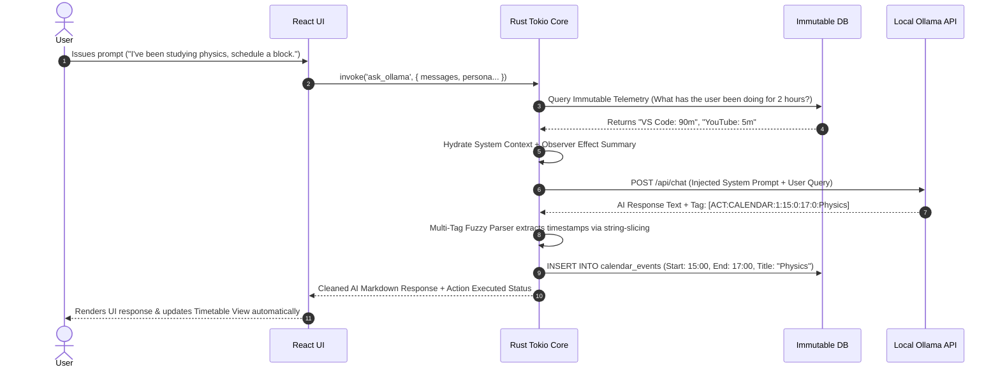

# Omni-Dashboard (Omni-Core) 

> **Omni-Dashboard is an autonomous, cross-platform (Linux & Windows), local-first productivity app and your very own AI helper. It features a background observer, strict data sovereignty, dedicated GPU acceleration, and a PiecesOS-style live memory DB designed to get that discipline to Workmaxx/Gradesmaxx.**

Welcome to the edge of productivity. If you are a student, a developer, or a professional who's tired of paying for ten different subscription apps, constantly getting distracted, and worrying about corporations harvesting your private data, then **Omni-Core is your ultimate solution.**

## Why this fits in (For the Hack Club)

Omni-Dashboard completely replaces fragmented, cloud-dependent SaaS applications with a unified, hyper-fast, cross-platform, AND offline platform. Built with **Tauri v2** and a **Rust** backend, it pairs an embedded database with multiple local AI models powered by **Ollama** (requiring a local Ollama server with models like `llama3.2:3b`, `qwen2.5-coder:3b`, etc.). 

Beyond standard task management, Omni-Core introduces the **Observer Effect**: an un-bypassable background tracker that logs your active screen time across Linux (X11 & Wayland) and Windows, categorizes your behavior (Deep Work vs. Distraction), and streams this live context directly into the AI's neural memory. **The AI knows what you are doing in real-time.** It provides accountability, auto-generated flashcards, automated meeting summaries, and offline music playback—all without sending a single byte of your data to the cloud.

---

## 📋 Table of Contents
1. [System Architecture & Design Philosophy](#1-system-architecture--design-philosophy)
2. [Deep Dive: Core Engineering Modules](#2-deep-dive-core-engineering-modules)
   - [2.1 Autonomous Neural Action Bridge (How the AI "Does" Things)](#21-autonomous-neural-action-bridge)
   - [2.2 Local RAG & PDF Textbook Engine (The AI Study Buddy)](#22-local-rag--pdf-textbook-engine)
   - [2.3 System Telemetry, GPU Acceleration & Dynamic VRAM Purging](#23-system-telemetry-gpu-acceleration--dynamic-vram-purging)
   - [2.4 Multimodal Audio & Zero-Cloud TTS Pipeline (Offline Spotify + Voices)](#24-multimodal-audio--zero-cloud-tts-pipeline)
   - [2.5 The Observer Effect: Cross-Platform Telemetry & Live Memory](#25-the-observer-effect-cross-platform-telemetry--live-memory)
   - [2.6 Advanced Automation: Flashcards & Auto-Summaries](#26-advanced-automation-flashcards--auto-summaries)
   - [2.7 Full Factory Reset & Data Sovereignty](#27-full-factory-reset--data-sovereignty)
3. [Relational Database Schema (SQLite WAL)](#3-relational-database-schema-sqlite-wal)
4. [AI Persona Engine & Prompt Matrix](#4-ai-persona-engine--prompt-matrix)
5. [Tauri IPC API Reference (For Developers)](#5-tauri-ipc-api-reference)
6. [Comprehensive Setup & Build Protocol (Arch Linux & Windows)](#6-comprehensive-setup--build-protocol)
7. [Troubleshooting & Hardware Acceleration Notes](#7-troubleshooting--hardware-acceleration-notes)
8. [Images of Project](#8-images-of-project)
9. [License & Terms of Use](#9-license--terms-of-use)

---

## 1. 🏛️ System Architecture & Design Philosophy

Omni-Dashboard keeps a strict **Local-First Architecture (LFA)**, thinking of your computer as an impenetrable fortress. There are no API keys, no cloud syncing, or data harvesting. 

All application state (your tasks), vector searchs (how the AI finds information in your textbooks), user screens (what apps you are using), and chat context remain strictly confined to your laptop (or device). It uses asynchronous `tokio` threads (a Rust tool that allows multiple things to happen at once without freezing the app) to prevent the user interface from freezing when the AI is thinking hard too.

```text
┌───────────────────────────────────────────────────────────────────────────────────────────┐
│                                    REACT / TS FRONTEND                                    │
│   (Vite, Tailwind CSS, Lucide Icons, Modern Dark UI, High-Frequency Polling Hooks)        │
│   This is the beautiful visual layer you interact with, built with standard web tech.     │
└────────────────────────────────────────────┬──────────────────────────────────────────────┘
                                             │
                                             │ Tauri IPC Bridge (Asynchronous payloads)
                                             │ (The invisible messenger carrying your clicks)
                                             ▼
┌───────────────────────────────────────────────────────────────────────────────────────────┐
│                                   RUST TAURI CORE DAEMON                                  │
│                               (The high-speed brain of the app)                           │
│                                                                                           │
│  ┌───────────────────────┐  ┌───────────────────────┐  ┌───────────────────────────────┐  │
│  │   Context Hydrator    │  │  Fuzzy Action Parser  │  │  Telemetry Monitor (Tokio)    │  │
│  │ (Live Memory Inject)  │  │   ([ACT:...] Loop)    │  │ (Watches what apps you use)   │  │
│  └───────────┬───────────┘  └───────────┬───────────┘  └──────────────┬────────────────┘  │
└──────────────┼──────────────────────────┼─────────────────────────────┼───────────────────┘
               │                          │                             │
               ▼                          ▼                             ▼
┌──────────────────────────┐  ┌──────────────────────────┐  ┌───────────────────────────────┐
│  EMBEDDED SQLITE DB      │  │  OLLAMA REST API         │  │  PIPER TTS / Rodio / cpal     │
│  (WAL Mode Enabled)      │  │  (`127.0.0.1:11434`)     │  │  (ONNX Runtime / Loopback)    │
│  (Your private vault)    │  │  (The local AI models)   │  │  (The voice & music engines)  │
└──────────────────────────┘  └──────────────────────────┘  └───────────────────────────────┘

**This and a few of the following README diagrams are generated by AI**
```

### High-Fidelity Data Flow Sequence (How a Command Works)
Usually, AI like ChatGPT just spits out text, and *you* have to copy-paste it into your calendar. Omni-Core skips the you part entirely.



---

## 2. 🔬 Deep Dive: Core Engineering Modules

### 2.1 Autonomous Neural Action Bridge (How the AI "Does" Things)
Traditional AI chat systems are passive. Well, Omni-Core isn't "passive". It uses a high-reliability **Zero-Math Fuzzy Parsing Tag Execution Bridge** to let the AI actually *do* work for you.

#### Tag Format Specifications
Small, highly compressed AI models (which you need if you are running them on a normal student laptop) often hallucinate or break when trying to write complex code. To ensure 100% execution reliability, Omni-Core forces the AI to use simple, strict bracketed tags:
1. **Task Creation:** `[ACT:TASK:<QUADRANT_1_TO_4>:<TITLE>]`
2. **Calendar Scheduling:** `[ACT:CALENDAR:<OFFSET_DAYS>:<START_HOUR>:<START_MIN>:<END_HOUR>:<END_MIN>:<TITLE>]`
3. **Pomodoro Timer Ignition:** `[ACT:TIMER:<FOCUS_MINUTES>:<BREAK_MINUTES>]`
4. **Record Deletion:** `[ACT:DELETE:<TABLE_NAME>:<RECORD_ID>]`
5. **Task Completion:** `[ACT:COMPLETE:<TASK_ID>]`

#### Parsing Engine Mechanics
* **Regex-Free Tokenizer:** The Rust daemon will scan the AI's response looking for `[ACT:`. This is mathematically cheaper for your computer's CPU and highly resilient to AI mistakes.
* **AM/PM & String Normalization:** If the AI makes a mistake and types "5 PM" instead of the 24-hour "17:00", the engine automatically catches it, cleans the text, and calculates the exact mathematical timestamp.
* **Concurrency Safety:** If the AI creates 5 tasks at once, the system applies a tiny 2-millisecond delay (`std::thread::sleep`) between saving each one to guarantee they all get a unique ID in your database without colliding.

---

### 2.2 Local RAG & PDF Textbook Engine (The AI Study Buddy)
"RAG" stands for Retrieval-Augmented Generation. In plain English, it means giving the AI the ability to read your specific documents. Therefore,This can handle massive academic textbook ingestion completely on-device.

1. **Extraction & Chunking:** When you upload a 500-page Biology PDF, the `lopdf` tool scans every single page, stripping out the visual formatting to grab the pure text.
2. **Persistence:** These pages are instantly stored in your local database.
3. **Keyword Heuristic (Smart Searching):** When you attach a textbook to the chat and ask a question, the app extracts the important words from your question. It then mathematically scores every page in the book based on how often those words appear. It grabs the top 5 most relevant pages and secretly feeds them to the AI before it answers. **This forces the AI to cite specific page numbers from your actual textbook, eliminating fake answers (hallucinations).**

---

### 2.3 System Telemetry, GPU Acceleration & Dynamic VRAM Purging
Running Artificial Intelligence locally requires careful management of System RAM and Dedicated VRAM (Video Memory on your Graphics Card). Omni-Core includes a comprehensive hardware-aware engine to maximize performance across modern desktop and budget laptop hardware.

* **Dual-Engine System & GPU Diagnostics:** The Rust daemon continuously queries system memory and dedicated GPU metrics (via `nvidia-smi` on NVIDIA systems and `sysinfo` for CPU/RAM). The UI displays real-time CPU utilization, system RAM usage, GPU VRAM allocation (used vs. total), and GPU compute percentage.
* **Low-VRAM Adaptive Context Clamping:** Small dedicated GPUs (such as the **NVIDIA GeForce MX450 2GB GDDR6, TU117 architecture**) easily run out of memory if an LLM allocates huge context windows (e.g., 16k tokens requires $\approx$ 3.8 GB VRAM, triggering a slow CPU fallback). Omni-Core automatically detects GPUs with $\le$ 3 GB VRAM and clamps the Ollama context window (`num_ctx`) to **4096 tokens**. This guarantees that 100% of the model layers and KV cache stay within VRAM, delivering 4–5$\times$ faster inferencing speeds with zero crashing.
* **Dynamic VRAM Purging:** When switching between different AI tasks (e.g., moving from general chat with `llama3.2` to coding with `qwen2.5-coder`), Omni-Core actively invokes `flush_vram`. It sends an eviction payload to Ollama (`keep_alive: 0`), flushing the prior model from VRAM before spinning up the next model.

---

### 2.4 Multimodal Audio & Zero-Cloud TTS Pipeline (Offline Spotify + Voices)
We provide lightning-fast voice generation and a built-in music player that works seamlessly on both Linux and Windows.

* **Cross-Platform Piper TTS Engine:** The AI speaks using offline neural ONNX voice models. The system automatically selects the platform-appropriate binary (`piper` on Linux or `piper.exe` on Windows) and adjusts cadence dynamically (`Length Scale = 200 / Words Per Minute`).
* **YT-DLP Offline Vault:** Omni-Core allows searching YouTube Music directly inside the app. Clicking download invokes native `yt-dlp` and `ffmpeg` to fetch and tag raw `.mp3` files directly into your local app storage. Platform-specific execution flags (silent flags on Windows, non-blocking pipe streams on Linux) ensure smooth, unthrottled downloads.
* **Offline Flow-State Playback:** Songs play locally via Rodio and platform audio backends (PulseAudio / PipeWire on Linux, WASAPI on Windows) with full offline seeking, playlist creation, and volume control.

---

### 2.5 The Observer Effect: Cross-Platform Telemetry & Live Memory
The psychological foundation of Omni-Dashboard is built for accountability and deep focus.

1. **Cross-Platform Active Window Detection:**
   * **Linux:** Uses `active-win-pos-rs` to read active window titles and application names across both **Wayland** (via compositor protocols/XWayland) and **X11**.
   * **Windows:** Uses native Win32 APIs and UIAutomation COM walkers.
2. **Behavioral Categorization:** Every 10 seconds, the background thread categorizes your active foreground activity into **"Deep Work"** (VS Code, terminal, PDF reader), **"Research"**, or **"Distraction"** (YouTube, social media, games).
3. **Immutable Persistence:** Activity entries are written into the `immutable_telemetry` SQLite table. Under normal operation, distraction logs cannot be retroactively erased or falsified.
4. **Live Memory Stream:** Omni-Core summarizes your recent behavioral history and injects it into Ollama's active system prompt. If you've been working diligently, your AI assistant adjusts to support your flow; if you've been procrastinating, strict personas (like Victor or Chloe) will call you out immediately.

---

### 2.6 Advanced Automation: Flashcards & Auto-Summaries
* **Auto-Flashcard Generation:** Analyzes markdown study notes and RAG textbook extracts to generate structured flashcard decks for active recall.
* **Meeting & Class Summarization:** Hit "AI Summarize" on any note to generate bulleted takeaways, action items, and executive summaries via your local LLM.
* **Audio Capture Framework:** Configured for local audio capture (PulseAudio/PipeWire monitor sources on Linux, WASAPI loopback on Windows) for on-device transcription.

---

### 2.7 Full Factory Reset & Data Sovereignty
In keeping with strict data sovereignty, Omni-Core puts the user in total control of their data.

* **One-Click Nuclear Reset:** Located in **Settings $\to$ Danger Zone**, the **Full Factory Reset** button gives users the ability to completely purge all application data with a single click.
* **Safe Clean-Slate Wipe:** The backend drops all 20 relational database tables, performs an SQLite `VACUUM` to zero out file footprint, deletes temporary live memory stores (`omni_memory.db`), cleans cached downloaded audio files, and re-executes clean schema initialization with default settings.
* **No Broken State:** The application remains running and immediately returns to pristine out-of-the-box defaults without requiring manual terminal commands or config file deletions.

---

## 3. 💾 Relational Database Schema (SQLite WAL)

The database utilizes SQLite configured for Write-Ahead Logging (WAL). In simple terms: it allows the invisible background telemetry thread to write your screen-time logs at the exact same time you are reading a chat message, without locking up or crashing the app.

```sql
CREATE TABLE IF NOT EXISTS tasks (
    id TEXT PRIMARY KEY,
    title TEXT NOT NULL,
    quadrant INTEGER NOT NULL, -- 1: Do First, 2: Schedule, 3: Delegate, 4: Eliminate
    completed INTEGER NOT NULL
);

CREATE TABLE IF NOT EXISTS notes (
    id TEXT PRIMARY KEY,
    title TEXT NOT NULL,
    content TEXT NOT NULL,
    course_id TEXT NOT NULL
);

CREATE TABLE IF NOT EXISTS courses (
    id TEXT PRIMARY KEY,
    code TEXT NOT NULL,
    name TEXT NOT NULL,
    description TEXT NOT NULL,
    color TEXT NOT NULL
);

CREATE TABLE IF NOT EXISTS workspaces (
    id TEXT PRIMARY KEY,
    name TEXT NOT NULL,
    created_at INTEGER NOT NULL
);

CREATE TABLE IF NOT EXISTS chat_sessions (
    id TEXT PRIMARY KEY,
    title TEXT NOT NULL,
    workspace_id TEXT NOT NULL DEFAULT '',
    created_at INTEGER NOT NULL,
    updated_at INTEGER NOT NULL
);

CREATE TABLE IF NOT EXISTS chats (
    id TEXT PRIMARY KEY,
    session_id TEXT NOT NULL DEFAULT 'default_session',
    role TEXT NOT NULL,
    content TEXT NOT NULL,
    timestamp INTEGER NOT NULL
);

CREATE TABLE IF NOT EXISTS settings (
    key TEXT PRIMARY KEY,
    value TEXT NOT NULL
);

CREATE TABLE IF NOT EXISTS focus_sessions (
    id TEXT PRIMARY KEY,
    task_id TEXT NOT NULL,
    duration_minutes INTEGER NOT NULL,
    timestamp INTEGER NOT NULL,
    title TEXT
);

CREATE TABLE IF NOT EXISTS playlists (
    id TEXT PRIMARY KEY,
    name TEXT NOT NULL,
    tags TEXT NOT NULL DEFAULT '[]',
    songs TEXT NOT NULL DEFAULT '[]',
    created_at INTEGER NOT NULL
);

CREATE TABLE IF NOT EXISTS offline_songs (
    id TEXT PRIMARY KEY,
    title TEXT NOT NULL,
    artist TEXT NOT NULL,
    duration TEXT NOT NULL,
    local_path TEXT NOT NULL,
    thumbnail_url TEXT NOT NULL,
    source TEXT NOT NULL
);

CREATE TABLE IF NOT EXISTS textbooks (
    id TEXT PRIMARY KEY,
    title TEXT NOT NULL,
    author TEXT NOT NULL,
    course_id TEXT NOT NULL,
    file_path TEXT NOT NULL,
    total_pages INTEGER NOT NULL,
    created_at INTEGER NOT NULL
);

CREATE TABLE IF NOT EXISTS textbook_pages (
    id TEXT PRIMARY KEY,
    textbook_id TEXT NOT NULL,
    page_number INTEGER NOT NULL,
    content TEXT NOT NULL
);

CREATE TABLE IF NOT EXISTS book_sets (
    id TEXT PRIMARY KEY,
    name TEXT NOT NULL,
    created_at INTEGER NOT NULL
);

CREATE TABLE IF NOT EXISTS book_set_items (
    set_id TEXT NOT NULL,
    textbook_id TEXT NOT NULL,
    PRIMARY KEY (set_id, textbook_id)
);

CREATE TABLE IF NOT EXISTS calendar_events (
    id TEXT PRIMARY KEY,
    title TEXT NOT NULL,
    description TEXT NOT NULL DEFAULT '',
    start_time INTEGER NOT NULL, -- Unix epoch time in milliseconds
    end_time INTEGER NOT NULL,   -- Unix epoch time in milliseconds
    event_type TEXT NOT NULL,
    tags TEXT NOT NULL DEFAULT '[]',
    color TEXT NOT NULL DEFAULT '#3b82f6',
    is_all_day INTEGER NOT NULL DEFAULT 0
);

CREATE TABLE IF NOT EXISTS immutable_telemetry (
    id TEXT PRIMARY KEY,
    timestamp INTEGER NOT NULL,
    app_name TEXT NOT NULL,
    window_title TEXT NOT NULL,
    category TEXT NOT NULL -- Tags: "Deep Work", "Research", "Leisure", "Distraction"
);

CREATE TABLE IF NOT EXISTS live_memory_summaries (
    id TEXT PRIMARY KEY,
    timestamp INTEGER NOT NULL,
    summary_text TEXT NOT NULL
);
```

---

## 4. 🎭 AI Persona Engine & Prompt Matrix

Omni-Core features 10 distinctly engineered AI personalities. Different studying situations require different coaching styles. Changing the persona literally changes the hidden "System Prompt" fed to the AI. 

| Persona | Gender & Style | Dynamic Voice Model | System Archetype & Behavioral Objective |
| :--- | :--- | :--- | :--- |
| **Victor** | Strict Male | `en_US-bryce-medium` | Tactical drill-sergeant mentor. Uncompromising precision, zero fluff, demands strict task accountability. **Utilizes telemetry to harshly penalize your distractions.** |
| **Morgan** | Strict Female | `en_US-amy-medium` | Executive strategist and professor. Focuses on intellectual rigor, logic, and rapid execution. Ideal for academic textbook extraction. |
| **Sam** | Normal Male | `en_US-ryan-high` | Approachable roommate. Balanced guidance using clear analogies and friendly conversational tone. |
| **Maya** | Normal Female | `en_GB-semaine-medium` | Empathetic study mentor. Structured learning support, clear organization, and articulate explanations. **Excellent for generating study flashcards.** |
| **Leo** | Quirky Male | `en_US-joe-medium` | Sarcastic, hackathon-tier developer. Dry wit, deadpan humor, highly efficient code and problem solving. Maps perfectly to coding tasks. |
| **Felix** | Quirky Male | `en_GB-alan-medium` | High-energy tech tinkerer. Uses analogies, pop-culture metaphors, and rapid structural breakdowns. |
| **Ziggy** | Quirky Male | `en_US-danny-low` | Indie radio philosopher. Deep conceptual curiosity, surrealist humor, and calm problem-solving. |
| **Nova** | Quirky Female | `en_GB-cori-high` | High-octane hype-woman. Fast-paced banter, dramatic flair, intense positive motivation. **Best utilized for maintaining momentum during long 2-hour Pomodoro study sessions.** |
| **Aria** | Quirky Female | `en_GB-alba-medium` | Theatrical mad scientist. Treats productivity, tasks, and notes as scientific experiments. |
| **Chloe** | Quirky Female | `en_GB-jenny_dioco-medium` | Brutally honest sister figure. Calls out procrastination instantly based on active-window telemetry, offers zero-filter advice with affectionate humor. |

---

## 5. 🔌 Tauri IPC API Reference (For Developers)

The visual frontend interacts with the hidden Rust engine via IPC (Tauri v2 Commands). Every function is strictly typed and handles potential software errors gracefully.

### System, Telemetry & Reset Commands
```typescript
// System & GPU Telemetry (RAM, CPU, NVIDIA dGPU VRAM & Compute)
invoke("get_telemetry"): Promise<{
  ram_total: string,
  ram_used: string,
  ram_percent: number,
  cpu_count: number,
  cpu_percent: number,
  gpu_name: string,
  vram_total: string,
  vram_used: string,
  vram_percent: number,
  gpu_util: string,
  has_gpu: boolean
}>;

// The Observer Effect (Cross-platform active window telemetry)
invoke("get_active_app_telemetry"): Promise<AppTelemetry>;

// Aggregate telemetry stats for Dashboard graphs
invoke("get_telemetry_stats"): Promise<TelemetryStats>;

// Payload delivery to Ollama to unload heavy AI models instantly
invoke("flush_vram", { modelTier: string }): Promise<void>;

// Full Factory Reset (Drops all tables, clears audio/memory caches, resets defaults)
invoke("factory_reset"): Promise<void>;

// Profile Configuration
invoke("get_settings"): Promise<UserSettings>;
invoke("save_settings", { settings: UserSettings }): Promise<void>;
```

### AI, Action Bridge, & Chat Commands
```typescript
invoke("ask_ollama", {
  messages: Array<{ role: string, content: string }>,
  persona: string,
  modelTier: string,
  searchWeb: boolean,
  attachedTextbook?: TextbookAttachment,
  currentDateStr: string,
  currentEpochMs: number,
  startOfTodayMs: number // Critical for calculating calendar timestamps dynamically
}): Promise<string>;
```

### Productivity & Calendar Matrix Commands
```typescript
//Priority Matrix Interactions
invoke("get_tasks"): Promise<TaskItem[]>;
invoke("add_task", { id: string, title: string, quadrant: number }): Promise<void>;
invoke("delete_task", { id: string }): Promise<void>;

// Advanced Timetable Interactions
invoke("add_calendar_event", {
  id: string, title: string, description: string, start_time: number,
  end_time: number, event_type: string, tags: string[], color: string, is_all_day: boolean
}): Promise<void>;
invoke("get_calendar_events_in_range", { start: number, end: number }): Promise<CalendarEventItem[]>;
invoke("delete_calendar_event", { id: string }): Promise<void>;
```

### Document Ingestion & Storage Commands
```typescript
invoke("import_pdf_textbook", { filePath: string, title: string, author: string, courseId: string }): Promise<TextbookItem>;
invoke("get_textbooks"): Promise<TextbookItem[]>;
invoke("delete_textbook", { id: string }): Promise<void>;
```

### Audio Pipeline Commands
```typescript
//generate artificial voices
invoke("read_aloud", { text: string, wpm: number, persona: string }): Promise<void>;
invoke("stop_reading"): Promise<void>;

// Invokes native yt-dlp binary to rip raw .mp3 data from YouTube
invoke("download_yt_song", { videoId: string, title: string, artist: string, duration: string, thumbnailUrl: string }): Promise<OfflineSongItem>;
```

---

## 6. ⚙️ Comprehensive Setup & Build Protocol (Arch Linux & Windows)

Omni-Dashboard is built to run natively on both Arch Linux (and other Linux distributions) and Windows 10/11 with zero source code modifications.

### 6.1 Host System Prerequisites

#### Linux (Arch Linux) Setup
Install required system libraries, WebKitGTK, GStreamer, audio backends, and utilities:
```bash
sudo pacman -S --needed \
  base-devel \
  webkit2gtk-4.1 \
  gtk3 \
  libsoup3 \
  libappindicator-gtk3 \
  gst-plugins-base \
  gst-plugins-good \
  gst-plugins-bad \
  gst-libav \
  openssl \
  curl \
  wget \
  ffmpeg \
  yt-dlp \
  grim \
  scrot \
  imagemagick \
  nodejs \
  npm \
  git-lfs
```

##### NVIDIA GPU Acceleration (CUDA for Ollama):
To enable discrete GPU acceleration (e.g., NVIDIA GeForce MX450, GTX, or RTX cards):
```bash
# Arch Linux CUDA-enabled Ollama and PRIME offload utility:
sudo pacman -S ollama-cuda nvidia-prime
```
> [!TIP]
> Ensure you install `ollama-cuda` instead of generic `ollama` from the Arch repositories so Ollama offloads LLM layers to your NVIDIA GPU!

#### Windows Setup
* **Node.js:** Version 18 or higher.
* **Rust Toolchain:** Install via `rustup` (`rustup default stable-x86_64-pc-windows-msvc`).
* **Visual Studio Build Tools:** Install Visual Studio 2022 Build Tools with the "Desktop development with C++" workload selected.
* **FFmpeg & yt-dlp:** Ensure `ffmpeg` and `yt-dlp` are installed and added to your Windows system `PATH`.
* **Git LFS:** Run `git lfs install`.

---

### 6.2 Ollama Environment Setup
[Ollama](https://ollama.com/) powers all local AI processing. Start the server and download the recommended model suite:

```bash
# 1. Start the Ollama server
ollama serve

# 2. Pull the models
# General conversational brain (Fast reasoning)
ollama pull llama3.2:3b

# Coding & Logic brain (Used for math and development)
ollama pull qwen2.5-coder:3b

# High Performance brain (Ultra-fast execution)
ollama pull phi4-mini:latest

# Vision / Image Engine (Screen inspection & hotkey pullup)
ollama pull qwen3.5:4b

# Textbook Scanner brain (Used for RAG and PDFs)
ollama pull nemotron-mini:latest

# Vector Embeddings engine (Required for PDF textbook search)
ollama pull nomic-embed-text
```

> [!NOTE]
> On laptops with $\le$ 3GB VRAM (such as the GeForce MX450 2GB), Omni-Core automatically clamps the context window to `4096` tokens so the entire model fits in VRAM without spilling into slow CPU swap.

---

### 6.3 Piper TTS Runtime Setup
Verify the `piper` directory structure within the `src-tauri` folder:
```text
src-tauri/
└── piper/
    ├── piper/
    │   ├── piper        # Linux executable (chmod +x)
    │   └── piper.exe    # Windows executable
    └── voices/
        ├── en_US-ryan-high.onnx
        ├── en_US-amy-medium.onnx
        ├── en_US-bryce-medium.onnx
        └── ... (.json config files alongside .onnx)
```
On Arch Linux, you can also install piper via AUR (`yay -S piper-tts-bin`) or symlink it into the above directory.

---

### 6.4 Development Compilation & Execution

Clone the repository and install frontend dependencies:
```bash
# 1. Clone the repository
git clone https://github.com/Koundinya-Git/omni-dashboard.git
cd omni-dashboard

# If working on the dedicated Linux branch:
git checkout for-linux

# 2. Install web dependencies
npm install
```

#### Running on Hybrid Graphics (Optimus / PRIME Laptops):
On dual-GPU laptops (Intel/AMD iGPU + NVIDIA dGPU):
* **Recommended:** Launch standard development mode:
  ```bash
  npm run tauri dev
  ```
  This runs the WebKitGTK user interface smoothly on the battery-efficient integrated GPU, while the background Ollama CUDA daemon utilizes 100% of your NVIDIA dGPU for inference.
* **Running with PRIME Render Offload:**
  ```bash
  prime-run npm run tauri dev
  ```
  Omni-Dashboard automatically detects `__NV_PRIME_RENDER_OFFLOAD=1` and sets `WEBKIT_DISABLE_DMABUF_RENDERER=1` to prevent Wayland compositor DMA-BUF protocol errors.

---

### 6.5 Production Package & Binary Compilation

To build standalone release packages:

#### On Linux:
```bash
npm run tauri build
```
Generates `.AppImage` and `.deb` binaries under `src-tauri/target/release/bundle/`.

#### On Windows:
```bash
npm run tauri build
```
Generates standalone `.exe` and `.msi` installers under `src-tauri\target\release\bundle\`.

---

## 7. 🛠️ Troubleshooting & Hardware Acceleration Notes

### NVIDIA dGPU Not Being Used by Ollama (Arch Linux)
* **Symptom:** AI responses are slow; `nvidia-smi` shows 0MB VRAM used by `ollama_llama_server`.
* **Cause:** Arch Linux's default `extra/ollama` package is compiled for CPU only.
* **Fix:** Install `sudo pacman -S ollama-cuda`. Then restart the service: `sudo systemctl restart ollama` or `ollama serve`. Verify via `nvidia-smi` during a chat query.

### WebKitGTK Wayland Protocol Error 71 with `prime-run`
* **Symptom:** Application crashes at startup with `Gdk-Message: Error 71 (Protocol error) dispatching to Wayland display`.
* **Cause:** WebKitGTK DMA-BUF rendering conflict with NVIDIA proprietary drivers under Wayland.
* **Fix:** Omni-Dashboard contains a built-in guard in `src-tauri/src/main.rs`. Alternatively, launch without `prime-run` (Tauri UI on iGPU, Ollama on dGPU), or set:
  ```bash
  export WEBKIT_DISABLE_DMABUF_RENDERER=1
  npm run tauri dev
  ```

### Music Player Fails to Download or Play (Linux)
* **Symptom:** YouTube download errors out or audio does not play.
* **Cause:** Missing `yt-dlp`, `ffmpeg`, or GStreamer plugins.
* **Fix:** Ensure all GStreamer codecs and `yt-dlp` are present:
  ```bash
  sudo pacman -S yt-dlp ffmpeg gst-plugins-base gst-plugins-good gst-plugins-bad gst-libav pipewire-pulse
  ```

### Screen Capture Not Working on Wayland
* **Cause:** Missing Wayland screen capture utility.
* **Fix:** Install `grim` (`sudo pacman -S grim`). On X11, install `scrot` or `imagemagick`.

### Full Factory Reset Procedure
* If you ever wish to completely wipe the local database and reset Omni-Core to a brand new out-of-the-box state, navigate to **Settings $\to$ Danger Zone $\to$ Full Factory Reset**. This drops all 20 tables, wipes temporary memory stores, cleans audio caches, vacuums storage, and reinitializes fresh defaults safely.

---
## 8. Images of Project:


---
## 9. License & Terms of Use

This project is open-source software licensed under the **GNU General Public License v3 (GPLv3)** with explicit additional terms as permitted under **GPLv3 Section 7**. Please refer to `Terms_and_Conditions.md` for complete legal definitions and liability waivers regarding AI hallucination, database management, and active telemetry tracking. By using, cloning, or compiling this application, you explicitly agree to the said Terms and Conditions in the `Terms_and_Conditions.md` file.

```text
GNU GENERAL PUBLIC LICENSE
Version 3, 29 June 2007

Copyright (C) 2026 Koundinya Gajulapalli

===============================================================================
ADDITIONAL TERMS UNDER GPLv3 SECTION 7
===============================================================================

1. Mandatory Title Preservation (Section 7c):
   Any modified version, derivative work, or reproduction of this software that 
   is distributed or published across any operating system (including Linux, 
   Windows, or macOS distributions) must explicitly retain and prominently display 
   the phrase "Omni-Dashboard" within its primary title, binary name, package 
   metadata, and naming identifiers.

2. Visible User-Facing Attribution (§7b):
   Distributors and developers of modified versions must preserve and display 
   clear, noticeable attribution to the original creator (Koundinya Gajulapalli) and provide 
   a direct link to the original repository within the user-facing interface 
   of the application (e.g., in the "About", "Settings", or "Dashboard" sections).
```

---
*Omni-Core Architecture Engine • Designed for Local Sovereignty and Maximum Student Discipline*
