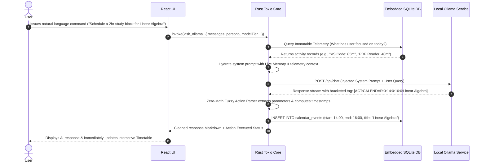

# Omni-Dashboard (Omni-Core)

[-FCC624?logo=linux&logoColor=black)](https://github.com/Koundinya-Git/omni-dashboard)
[](https://github.com/Koundinya-Git/omni-dashboard)
[](https://v2.tauri.app/)
[](https://www.rust-lang.org/)
[](https://vitejs.dev/)
[](https://ollama.com/)
[](LICENSE.md)

> **An autonomous, cross-platform (Linux & Windows), local-first productivity ecosystem and intelligent desktop assistant. Featuring real-time behavioral telemetry, strict data sovereignty, dedicated GPU acceleration, and a live memory database designed for sustained focus and deep work.**

Welcome to the edge of personal productivity. Omni-Dashboard provides an all-in-one, completely offline workspace that replaces fragmented, cloud-dependent SaaS subscriptions with an ultra-responsive desktop application. Built with **Tauri v2** and a **Rust** Tokio core, it pairs a local embedded SQLite database with local Large Language Models (LLMs) served through **Ollama**—ensuring that every task, note, document, and chat remains strictly on your device.

---

## 📦 Precompiled Binaries & Official Releases

If you don't want to install Node.js, Rust, or compile from source, standalone precompiled packages for **Windows** and **Linux** are available directly on the [**GitHub Releases**](https://github.com/Koundinya-Git/omni-dashboard/releases) page:

| Operating System | Package Format | Installation / Execution Instructions |
| :--- | :--- | :--- |
| **Linux (Universal)** | `.AppImage` | Download `omni-dashboard.AppImage`, make it executable (`chmod +x omni-dashboard.AppImage`), and run! |
| **Linux (Debian / Ubuntu / Mint)** | `.deb` | Download `omni-dashboard.deb` and install via `sudo dpkg -i omni-dashboard.deb`. |
| **Linux (Arch Linux / Standalone)** | Binary (`omni-dashboard`) | Download the standalone executable, `chmod +x omni-dashboard`, and execute `./omni-dashboard`. |
| **Windows (Installer)** | `.msi` / `.exe` | Download `omni-dashboard-setup.exe` or `.msi`, double-click, and follow the standard installer wizard. |
| **Windows (Portable)** | `.zip` | Download and extract portable standalone executable to run directly without admin privileges. |

> [!NOTE]
> Regardless of whether you download a precompiled release or compile from source, both **Windows** and **Linux** versions originate from this exact same unified codebase. You only need a running [Ollama](https://ollama.com/) instance on your computer with your chosen models!

---

## ⚡ 5-Minute Quick Start Guide (Building from Source)

Get Omni-Dashboard up and running on your machine in three simple steps:

### 🐧 For Linux (Arch Linux / Ubuntu / Debian / Fedora)
```bash
# 1. Clone repository & install dependencies
git clone https://github.com/Koundinya-Git/omni-dashboard.git && cd omni-dashboard

# On Arch Linux:
sudo pacman -S --needed base-devel webkit2gtk-4.1 gtk3 libsoup3 libappindicator-gtk3 gst-libav ffmpeg yt-dlp grim scrot ollama-cuda nodejs npm git-lfs

# 2. Start Ollama and download the base conversational model
ollama serve &
ollama pull llama3.2:3b

# 3. Install web packages and run!
npm install
npm run tauri dev
```

### 🪟 For Windows (Windows 10 / 11 PowerShell)
```powershell
# 1. Install prerequisites via winget & clone repository
winget install Gyan.FFmpeg yt-dlp.yt-dlp Ollama.Ollama OpenJS.NodeJS.LTS
git clone https://github.com/Koundinya-Git/omni-dashboard.git; cd omni-dashboard

# 2. Start Ollama and download the base conversational model
ollama serve
ollama pull llama3.2:3b

# 3. Install web packages and run!
npm install
npm run tauri dev
```

---

## 🌐 Product Overview

Modern productivity tools are increasingly fragmented, locked behind monthly subscriptions, and reliant on corporate servers that scrape user data. Omni-Dashboard solves this by unifying essential productivity systems into a single, offline platform:

* **Autonomous Neural Action Bridge:** An LLM that doesn't just chat, but directly creates tasks, populates calendar events, configures Pomodoro focus intervals, and organizes study material autonomously.
* **The Observer Effect:** An unobtrusive background tracker that monitors active window time across both Linux and Windows, automatically categorizing behavior into Deep Work vs. Distractions and hydrating the AI's short-term memory with real-time context.
* **Local RAG & Textbook Intelligence:** On-device document ingestion for academic textbooks and class notes, citing page numbers directly from local PDFs without external APIs.
* **Local-First Audio Engine:** Zero-cloud text-to-speech synthesis (Piper neural ONNX models) and a built-in offline music vault powered by native stream extraction (`yt-dlp`).
* **Hardware-Aware Acceleration:** Automatic telemetry monitoring for CPU, RAM, and dedicated NVIDIA GPU VRAM, including adaptive context window management for entry-level laptops (e.g., 2GB NVIDIA GeForce MX450).
* **Strict Data Sovereignty:** Absolute local ownership with zero telemetric phone-home, backed by a one-click **Full Factory Reset** in Settings.

---

## 📋 Table of Contents
1. [Cross-Platform Architecture & Guidelines](#1-cross-platform-architecture--guidelines)
2. [System Architecture & Data Flow](#2-system-architecture--data-flow)
3. [Complete Dependencies & Technology Stack](#3-complete-dependencies--technology-stack)
   - [3.1 External System Runtimes & CLI Tools](#31-external-system-runtimes--cli-tools)
   - [3.2 Rust Backend Dependencies (Cargo.toml)](#32-rust-backend-dependencies-cargotoml)
   - [3.3 Frontend NPM Dependencies (package.json)](#33-frontend-npm-dependencies-packagejson)
   - [3.4 Local AI Model Suite & Voice Models](#34-local-ai-model-suite--voice-models)
4. [Deep Dive: Core Engineering Modules](#4-deep-dive-core-engineering-modules)
   - [4.1 Autonomous Neural Action Bridge](#41-autonomous-neural-action-bridge)
   - [4.2 Local RAG & Academic Document Engine](#42-local-rag--academic-document-engine)
   - [4.3 Hardware Telemetry, GPU Acceleration & Adaptive VRAM Management](#43-hardware-telemetry-gpu-acceleration--adaptive-vram-management)
   - [4.4 Multimodal Audio & Zero-Cloud Voice Synthesis](#44-multimodal-audio--zero-cloud-voice-synthesis)
   - [4.5 The Observer Effect: Real-Time Context Engine](#45-the-observer-effect-real-time-context-engine)
   - [4.6 Study & Focus Automation](#46-study--focus-automation)
   - [4.7 Full Factory Reset & Data Sovereignty](#47-full-factory-reset--data-sovereignty)
5. [Relational Database Schema (SQLite WAL)](#5-relational-database-schema-sqlite-wal)
6. [AI Persona Engine & Prompt Matrix](#6-ai-persona-engine--prompt-matrix)
7. [Tauri IPC API Reference](#7-tauri-ipc-api-reference)
8. [Comprehensive Setup & Installation Protocol](#8-comprehensive-setup--installation-protocol)
   - [8.1 Linux Setup (Arch Linux, Ubuntu/Debian, Fedora)](#81-linux-setup)
   - [8.2 Windows Setup (Windows 10 / 11)](#82-windows-setup)
   - [8.3 Ollama Local AI Configuration](#83-ollama-local-ai-configuration)
   - [8.4 Piper TTS Runtime Setup](#84-piper-tts-runtime-setup)
   - [8.5 Development & Hybrid GPU Execution](#85-development--hybrid-gpu-execution)
   - [8.6 Production Release Packaging](#86-production-release-packaging)
9. [Troubleshooting & Operational Notes](#9-troubleshooting--operational-notes)
   - [9.1 Windows-Specific Troubleshooting](#91-windows-specific-troubleshooting)
   - [9.2 Linux-Specific Troubleshooting](#92-linux-specific-troubleshooting)
   - [9.3 General & AI Diagnostics](#93-general--ai-diagnostics)
10. [Application Showcase & Gallery](#10-application-showcase--gallery)
11. [License & Terms of Use](#11-license--terms-of-use)

---

## 1. 🔀 Cross-Platform Architecture & Guidelines

Omni-Dashboard is engineered as a **single, unified codebase** that runs natively on both **Linux** (supporting Wayland and X11 display servers) and **Windows** (10 and 11) without source-level conflicts or code forks.

```text
omni-dashboard/
├── src/                                  # 100% OS-Agnostic React + TypeScript Frontend
│   ├── components/                       # Dashboard widgets, Timetable, Chat, Flashcards
│   ├── lib/                              # Tauri IPC bridge wrappers (tauriIPC.ts)
│   └── App.tsx                           # Main HUD, router, telemetry & Danger Zone UI
├── src-tauri/                            # Rust Core Backend
│   ├── src/
│   │   ├── capture/
│   │   │   └── accessibility.rs          # Dual-Engine Observer (Win32 COM / Linux X11+Wayland)
│   │   ├── main.rs                       # IPC commands, screen grab, audio loopback, GPU telemetry
│   │   └── ...
│   ├── piper/                            # Neural Speech Synthesis
│   │   ├── piper/
│   │   │   ├── piper                     # Linux ELF binary
│   │   │   └── piper.exe                 # Windows PE executable
│   │   └── voices/                       # 10 ONNX neural voice models & configs (.onnx / .json)
│   ├── Cargo.toml                        # Dual-target compilation ([target.'cfg(windows)'.dependencies])
│   └── tauri.conf.json                   # Multi-target bundling (.AppImage, .deb, .msi, .exe)
├── package.json                          # Frontend NPM dependencies & scripts
└── vite.config.ts                        # Vite & Tailwind CSS v4 compiler config
```

### 1.1 Comparative Implementation Matrix

All platform divergences are abstracted at the Rust backend layer using compile-time feature gates (`#[cfg(target_os = "...")]`):

| Capability | Linux Implementation | Windows Implementation | Architectural Reason |
| :--- | :--- | :--- | :--- |
| **Window Telemetry (Observer)** | [`active-win-pos-rs`](file:///home/koundinyag/omni-dashboard/src-tauri/src/capture/accessibility.rs#L86-L134) (supports Wayland & X11) | Native Win32 API & `uiautomation` COM walker | Linux uses compositor protocol queries; Windows uses Win32 `GetForegroundWindow` & UIAutomation COM. |
| **Cargo Dependencies** | Standard Unix crates | `[target.'cfg(windows)'.dependencies]` (`uiautomation`, `windows`) | Prevents unneeded Win32 C/COM bindings from compiling or failing on Linux systems. |
| **Screen Capture** | [`grim`](file:///home/koundinyag/omni-dashboard/src-tauri/src/main.rs#L2854-L2870) (Wayland) $\to$ `scrot` $\to$ `import` (X11) | PowerShell `System.Drawing` script | Wayland requires protocol capture via `grim`; Windows uses .NET GDI handles. |
| **Meeting Audio Loopback** | PulseAudio / PipeWire (`-f pulse -i default`) | DirectShow (`-f dshow -i audio=Stereo Mix`) | Linux interfaces through the PulseAudio monitor source; Windows routes via DirectShow Stereo Mix. |
| **Audio Playback Engine** | `rodio` / PulseAudio & ALSA | `rodio` / WASAPI | Platform-agnostic playback via standard Rust audio abstractions. |
| **Piper TTS Binary** | Resolves `piper/piper/piper` or system `$PATH` | Resolves `piper/piper/piper.exe` | Binary executable suffix and execution path resolution. |
| **Process Spawning** | Standard non-blocking stdio pipelines | `CREATE_NO_WINDOW` (`0x08000000`) flag | Hides command prompts on Windows without breaking Linux stdout/stderr pipes. |
| **WebKitGTK Wayland Guard** | Sets `WEBKIT_DISABLE_DMABUF_RENDERER=1` under PRIME | Not applicable (WebView2) | Resolves WebKitGTK DMA-BUF Wayland protocol crashes on NVIDIA hybrid graphics. |
| **Database Engine** | Embedded SQLite (`rusqlite` bundled) | Embedded SQLite (`rusqlite` bundled) | Self-contained C compilation via MSVC or GCC; zero external SQLite installation needed. |
| **Binary Packages** | `.AppImage`, `.deb` | `.msi`, `.exe` | Tauri v2 multi-target bundling. |

### 1.2 Developer Guidelines for Cross-Platform Integrity

When contributing or extending features in Omni-Dashboard, adhere strictly to the following standards:

1. **Use Target Gates for OS-Specific Code:**
   * Always guard Windows-only code with `#[cfg(target_os = "windows")]`.
   * Always guard Linux-only code with `#[cfg(target_os = "linux")]` or `#[cfg(not(target_os = "windows"))]`.
2. **Never Add Windows-Only Crates Globally:**
   * Place Windows-specific crates strictly under `[target.'cfg(windows)'.dependencies]` in [`src-tauri/Cargo.toml`](file:///home/koundinyag/omni-dashboard/src-tauri/Cargo.toml).
3. **Always Use `apply_hidden_flag(&mut Command)`:**
   * When invoking external executables (such as `yt-dlp`, `ffmpeg`, or `piper`), apply the `apply_hidden_flag` utility. On Windows, this attaches `creation_flags(0x08000000)` to silence console popups; on Linux, it preserves non-blocking standard streams so processes do not hang.
4. **Prefer Cross-Platform Path Primitives:**
   * Never hardcode backslashes (`\`) or forward slashes (`/`). Always construct paths using `std::path::PathBuf` and `.join(...)`.
   * Use `std::env::temp_dir()` and Tauri's `app.path().app_data_dir()` for runtime caches.
5. **Keep Frontend Code 100% OS-Agnostic:**
   * The React/TypeScript layer should never branch on operating system heuristics. OS-dependent capabilities must always be abstracted behind uniform Tauri IPC commands.

---

## 2. 🏛️ System Architecture & Data Flow

Omni-Dashboard adheres strictly to a **Local-First Architecture (LFA)**. State mutations, vector heuristics, and background processes are processed entirely within the local host environment.

```text
┌───────────────────────────────────────────────────────────────────────────────────────────┐
│                                    REACT / TS FRONTEND                                    │
│   (Vite, Tailwind CSS, Lucide Icons, Modern Dark UI, High-Frequency Telemetry Hooks)      │
└────────────────────────────────────────────┬──────────────────────────────────────────────┘
                                             │
                                             │ Tauri v2 IPC Bridge (Asynchronous Tokio RPC)
                                             ▼
┌───────────────────────────────────────────────────────────────────────────────────────────┐
│                                   RUST TAURI CORE DAEMON                                  │
│                                                                                           │
│  ┌───────────────────────┐  ┌───────────────────────┐  ┌───────────────────────────────┐  │
│  │   Context Hydrator    │  │  Fuzzy Action Parser  │  │   Active Window Observer      │  │
│  │ (Live Memory Inject)  │  │   ([ACT:...] Loop)    │  │   (Wayland / X11 / Win32)     │  │
│  └───────────┬───────────┘  └───────────┬───────────┘  └──────────────┬────────────────┘  │
└──────────────┼──────────────────────────┼─────────────────────────────┼───────────────────┘
               │                          │                             │
               ▼                          ▼                             ▼
┌──────────────────────────┐  ┌──────────────────────────┐  ┌───────────────────────────────┐
│  EMBEDDED SQLITE DB      │  │  LOCAL OLLAMA ENGINE     │  │  PIPER TTS / Rodio / cpal     │
│  (WAL Mode Enabled)      │  │  (`127.0.0.1:11434`)     │  │  (ONNX Runtime / Loopback)    │
│  (Zero-Cloud Local Vault)│  │  (CUDA / DirectML Accel) │  │  (Audio & Voice Pipeline)     │
└──────────────────────────┘  └──────────────────────────┘  └───────────────────────────────┘
```

### High-Fidelity Data Flow Sequence



---

## 3. 📦 Complete Dependencies & Technology Stack

Omni-Dashboard is built with a minimal, high-performance technology footprint. The complete matrix of system runtimes, Rust backend crates, frontend packages, and local AI model suites is detailed below:

### 3.1 External System Runtimes & CLI Tools
| Runtime / Dependency | Minimum Version | Target Platform | Role in Omni-Dashboard |
| :--- | :--- | :--- | :--- |
| **Node.js & npm** | `v18.0.0+` | Linux & Windows | Executes the Vite compiler, development server, and React build pipelines. |
| **Rust Toolchain (Cargo)** | `v1.75.0+` (stable) | Linux & Windows | Compiles the Tauri v2 backend daemon, Tokio async loop, and bundled SQLite engine. |
| **Ollama** | Latest (`ollama-cuda` on Arch) | Linux & Windows | Local Large Language Model daemon serving model inference over `127.0.0.1:11434`. |
| **Piper TTS** | Standalone binary (`0.1.0+`) | Linux & Windows | Zero-cloud, low-latency neural speech synthesis via ONNX voice runtimes. |
| **yt-dlp** | Latest binary | Linux & Windows | Command-line YouTube Music audio extractor for the offline music vault. |
| **FFmpeg** | `v4.4+` | Linux & Windows | Audio stream transcode engine (extracting MP3s) and meeting audio loopback recorder. |
| **WebKit2GTK** | `webkit2gtk-4.1` | Linux | GTK3 web rendering engine powering the Tauri window on Linux. |
| **WebView2** | Evergreen Runtime | Windows 10/11 | Microsoft Edge Chromium rendering backend for Tauri on Windows. |
| **GStreamer Codecs** | Plugins Base, Good, Bad, Libav | Linux | Required for multimedia audio playback via Rodio on Linux. |
| **Grim / Scrot** | `grim` (Wayland), `scrot` (X11) | Linux | CLI utilities for capturing user screen states for multimodal AI inspection. |
| **Git LFS** | Git Large File Storage | Linux & Windows | Clones Piper `.onnx` voice models without git repository bloat. |

### 3.2 Rust Backend Dependencies (`src-tauri/Cargo.toml`)
| Crate | Version | Target Platform | Architecture Purpose |
| :--- | :--- | :--- | :--- |
| **`tauri`** | `2.0.0` | All | Tauri v2 desktop runtime, IPC command dispatcher, system tray, and asset protocol loader. |
| **`tauri-build`** | `2.0.0` | All (Build) | Build script integrating Tauri compilation hooks. |
| **`tokio`** | `1.0` (full) | All | Multi-threaded async runtime driving telemetry loops, timers, and HTTP requests. |
| **`rusqlite`** | `0.31.0` (bundled) | All | Embedded relational SQLite engine compiled directly into the binary with WAL concurrency. |
| **`active-win-pos-rs`** | `0.11.0` | All (Linux & Win) | Queries active foreground window titles, process names, and screen coordinates cross-platform. |
| **`sysinfo`** | `0.39.6` | All | High-frequency telemetry gathering for CPU core utilization and system RAM allocation. |
| **`rodio`** | `0.18.1` | All | Native audio playback engine driving the offline music player via ALSA/PulseAudio/WASAPI. |
| **`lopdf`** | `0.32` | All | Direct PDF text extraction tool scanning academic textbooks page-by-page for Local RAG. |
| **`pdf-extract`** | `0.7.2` | All | Auxiliary PDF extraction engine for parsing complex document formats. |
| **`reqwest`** | `0.12` (rustls-tls) | All | Asynchronous HTTP client communicating with Ollama REST endpoints and YouTube search. |
| **`ureq`** | `2.9` | All | Synchronous HTTP client used to dispatch rapid `keep_alive: 0` VRAM eviction payloads. |
| **`scraper`** | `0.19` | All | DOM/HTML parser extracting search results from YouTube Music endpoints. |
| **`serde` / `serde_json`** | `1.0` | All | Serialization and deserialization of typed IPC messages and database rows. |
| **`urlencoding`** | `2.1` | All | URL encoding and parameter sanitation helper. |
| **`base64`** | `0.23.0` | All | Encodes screenshots and images into Base64 strings for vision LLM payloads. |
| **`tauri-plugin-autostart`** | `2.0.0` | All | Provides OS startup integration for background monitoring. |
| **`tauri-plugin-dialog`** | `2.0.0` | All | Invokes native system file pickers for textbook and PDF uploads. |
| **`tauri-plugin-notification`** | `2.0.0` | All | Native desktop notifications for Pomodoro cycles, reminders, and alerts. |
| **`tauri-plugin-global-shortcut`** | `2.3.2` | All | Global system keybinding handler for toggling the quick AI overlay HUD. |
| **`uiautomation`** | `0.25` | Windows only | Windows UIAutomation COM tree walker for deep active window accessibility text extraction. |
| **`windows`** | `0.52` | Windows only | Direct Win32 API bindings for `Win32_Foundation` and `Win32_UI_WindowsAndMessaging`. |

### 3.3 Frontend NPM Dependencies (`package.json`)
| Package | Version | Layer | Description |
| :--- | :--- | :--- | :--- |
| **`react` & `react-dom`** | `^18.2.0` | UI Framework | Powers the declarative component hierarchy and state hooks. |
| **`vite`** | `^5.0.0` | Build System | Modern frontend development server providing instant HMR and Rollup bundling. |
| **`typescript`** | `^5.0.2` | Language | Full static typing across React components and Tauri IPC bindings. |
| **`tailwindcss`** | `^4.3.3` | Styling | Utility-first styling engine powering the dark-mode aesthetic. |
| **`@tailwindcss/vite`** | `^4.3.3` | Build Plugin | Direct Vite plugin compiler for Tailwind CSS v4. |
| **`lucide-react`** | `^1.26.0` | Iconography | High-density vector SVG icon library for dashboard widgets and controls. |
| **`recharts`** | `^3.10.1` | Data Viz | Composable SVG charting library rendering screen-time and telemetry charts. |
| **`react-markdown`** | `^10.1.0` | Markdown | Renders formatted markdown from AI conversational responses. |
| **`remark-gfm`** | `^4.0.1` | Markdown Plugin | GitHub Flavored Markdown plugin supporting tables, strikethroughs, and checklists. |
| **`@tauri-apps/api`** | `^2.11.1` | IPC Bridge | TypeScript client bindings for communicating with the Rust backend daemon. |

### 3.4 Local AI Model Suite & Voice Models
| Model Name | Parameter Size | Ollama Model Tag | Primary Role in Omni-Dashboard |
| :--- | :--- | :--- | :--- |
| **Llama 3.2** | 3 Billion | `llama3.2:3b` | General conversational assistant, study accountability, daily planning. |
| **Qwen 2.5 Coder** | 3 Billion | `qwen2.5-coder:3b` | Code analysis, syntax debugging, algorithmic math, technical tasks. |
| **Phi-4 Mini** | 3.8 Billion | `phi4-mini:latest` | Ultra-fast reasoning and one-click lecture note summarization. |
| **Qwen 2.5/3.5 Vision** | 4 Billion | `qwen3.5:4b` | Multimodal visual inspection of screenshots and diagrams. |
| **Nemotron Mini** | 4 Billion | `nemotron-mini:latest` | Academic textbook RAG extraction and context citation. |
| **Nomic Embed Text** | 137 Million | `nomic-embed-text` | High-density semantic vector embeddings for document similarity scoring. |
| **Piper Neural Voices** | 10 Models | `en_US-*-medium`, etc. | 10 distinct neural voices providing offline audio readouts for AI personas. |

---

## 4. 🔬 Deep Dive: Core Engineering Modules

### 4.1 Autonomous Neural Action Bridge
Omni-Dashboard utilizes a high-reliability **Zero-Math Fuzzy Parsing Tag Execution Bridge** that transforms natural-language conversational output into atomic database mutations.

#### Bracketed Tag Format Specifications
Small, quantized local models (such as 3B–4B parameter LLMs) can hallucinate or fail when tasked with outputting verbose JSON structures. Omni-Dashboard enforces ultra-compact bracketed action tags:
1. **Task Creation:** `[ACT:TASK:<QUADRANT_1_TO_4>:<TITLE>]`
2. **Calendar Scheduling:** `[ACT:CALENDAR:<OFFSET_DAYS>:<START_HOUR>:<START_MIN>:<END_HOUR>:<END_MIN>:<TITLE>]`
3. **Pomodoro Timer Ignition:** `[ACT:TIMER:<FOCUS_MINUTES>:<BREAK_MINUTES>]`
4. **Record Deletion:** `[ACT:DELETE:<TABLE_NAME>:<RECORD_ID>]`
5. **Task Completion:** `[ACT:COMPLETE:<TASK_ID>]`

#### Parsing Engine Mechanics
* **Regex-Free Tokenizer:** The Rust daemon scans the raw text stream for `[ACT:` delimiters via zero-copy string slices, ensuring minimal CPU overhead.
* **Timestamp Normalization:** The parser handles mixed 12-hour and 24-hour inputs (e.g., converting "4 PM" to mathematical millisecond epoch timestamps relative to the current local date).
* **Collision Prevention:** Multi-action blocks apply micro-sleep delays between insertions to guarantee monotonic SQLite primary keys.

---

### 4.2 Local RAG & Academic Document Engine
The Retrieval-Augmented Generation (RAG) module provides document analysis directly on-device without cloud ingestion:
1. **PDF Text Extraction:** Uploaded PDF textbooks and notes are parsed using `lopdf`, extracting structured textual streams on a per-page basis.
2. **Page-Indexed Storage:** Extracted text is indexed into the `textbook_pages` relational table.
3. **Keyword Heuristic Retrieval:** When a textbook is attached to a chat session, Omni-Core scores pages against query terms using keyword frequency and semantic matching, feeding the top 5 most relevant pages directly into the model context.
4. **Hallucination Elimination:** The model is strictly instructed to cite specific page numbers from the ingested document, ensuring answers are grounded in textbook material.

---

### 4.3 Hardware Telemetry, GPU Acceleration & Adaptive VRAM Management
Running LLMs on personal laptops requires precise resource budgeting to avoid thermal throttling, out-of-memory errors, and sluggish inferencing across both Windows and Linux.

* **Dual-Engine System Diagnostics:** The Rust daemon queries system RAM via `sysinfo` and dedicated GPU parameters via `nvidia-smi` (available out of the box with NVIDIA Windows drivers and on Linux). The dashboard displays real-time CPU usage, system RAM, GPU compute utilization, and active VRAM allocation.
* **Low-VRAM Adaptive Context Clamping:** On entry-level discrete GPUs (such as the **NVIDIA GeForce MX450 2GB GDDR6, TU117 architecture**, or GTX 1050 2GB/3GB), large context windows (e.g., 16,384 tokens) cause the KV cache to exceed available VRAM, forcing Ollama into slow CPU fallback mode. Omni-Core automatically detects GPUs with $\le$ 3GB VRAM on both Windows and Linux and caps `num_ctx` to **4096 tokens**. This guarantees that 100% of the model layers and KV cache remain in VRAM, delivering 4–5$\times$ faster generation.
* **Dynamic VRAM Purging:** When switching personas or tasks (e.g., transitioning from general chat on `llama3.2` to code generation on `qwen2.5-coder`), Omni-Core invokes `flush_vram`, dispatching an eviction payload (`keep_alive: 0`) to release previously loaded model weights from graphics memory.

---

### 4.4 Multimodal Audio & Zero-Cloud Voice Synthesis
Omni-Dashboard integrates on-device voice generation and an offline music player for deep focus sessions:

* **Neural Voice Synthesis (Piper TTS):** Synthesizes natural speech offline using ONNX voice models. Cadence is dynamically adjusted based on user-configured words-per-minute (`Length Scale = 200 / WPM`).
* **YT-DLP Offline Vault:** Users can query YouTube Music from within the application. Downloads are processed using native `yt-dlp` and `ffmpeg`, extracting audio directly into local MP3 storage.
* **Offline Playback Engine:** Songs are decoded and played locally via Rodio and platform backends (PulseAudio/PipeWire on Linux, WASAPI on Windows) with playlist curation and background playback.

---

### 4.5 The Observer Effect: Real-Time Context Engine
Built to maintain accountability, the background observer tracks active application usage:
1. **Multi-Compositor Window Detection:** Captures active window titles and process identifiers every 10 seconds via `active-win-pos-rs` on Linux (Wayland & X11) and Win32 UIAutomation on Windows.
2. **Behavioral Categorization:** Automatically categorizes foreground windows into **"Deep Work"** (IDE, terminal, text editor), **"Research"** (academic papers, docs), or **"Distraction"** (social media, video streaming).
3. **Immutable Logging:** Activity is committed to the `immutable_telemetry` table in SQLite.
4. **Live Memory Stream:** Summarized telemetry is injected into active chat sessions, allowing AI personas to acknowledge user progress or offer targeted coaching.

---

### 4.6 Study & Focus Automation
* **Auto-Flashcard Generation:** Automatically extracts key concepts from study notes and textbook chapters, generating spaced-repetition flashcard decks.
* **One-Click Note Summaries:** Formats lecture notes and study documents into executive summaries and action items using local models.
* **Meeting Transcription Pipeline:** Captures system audio loopback for offline speech-to-text processing (via DirectShow Stereo Mix on Windows or PulseAudio loopback on Linux).

---

### 4.7 Full Factory Reset & Data Sovereignty
In keeping with strict data sovereignty, Omni-Dashboard puts the user in total control of their data:
* **One-Click Nuclear Reset:** Located in **Settings $\to$ Danger Zone**, the **Full Factory Reset** button gives users the ability to completely purge all local application state with a single confirmation.
* **Complete State Sanitization:** Safely drops all 20 relational database tables, performs an SQLite `VACUUM` to reclaim disk space, purges temporary memory databases (`omni_memory.db`), cleans offline music caches, and reinitializes fresh tables with default configuration.
* **No Broken State:** The application remains running and returns to a pristine out-of-the-box state immediately.

---

## 5. 💾 Relational Database Schema (SQLite WAL)

The local database runs SQLite in Write-Ahead Logging (WAL) mode, enabling concurrent read and write operations across background telemetry threads and interactive UI sessions.

```sql
CREATE TABLE IF NOT EXISTS tasks (
    id TEXT PRIMARY KEY,
    title TEXT NOT NULL,
    quadrant INTEGER NOT NULL, -- 1: Do First, 2: Schedule, 3: Delegate, 4: Eliminate
    completed INTEGER NOT NULL
);

CREATE TABLE IF NOT EXISTS notes (
    id TEXT PRIMARY KEY,
    title TEXT NOT NULL,
    content TEXT NOT NULL,
    course_id TEXT NOT NULL
);

CREATE TABLE IF NOT EXISTS courses (
    id TEXT PRIMARY KEY,
    code TEXT NOT NULL,
    name TEXT NOT NULL,
    description TEXT NOT NULL,
    color TEXT NOT NULL
);

CREATE TABLE IF NOT EXISTS workspaces (
    id TEXT PRIMARY KEY,
    name TEXT NOT NULL,
    created_at INTEGER NOT NULL
);

CREATE TABLE IF NOT EXISTS chat_sessions (
    id TEXT PRIMARY KEY,
    title TEXT NOT NULL,
    workspace_id TEXT NOT NULL DEFAULT '',
    created_at INTEGER NOT NULL,
    updated_at INTEGER NOT NULL
);

CREATE TABLE IF NOT EXISTS chats (
    id TEXT PRIMARY KEY,
    session_id TEXT NOT NULL DEFAULT 'default_session',
    role TEXT NOT NULL,
    content TEXT NOT NULL,
    timestamp INTEGER NOT NULL
);

CREATE TABLE IF NOT EXISTS settings (
    key TEXT PRIMARY KEY,
    value TEXT NOT NULL
);

CREATE TABLE IF NOT EXISTS focus_sessions (
    id TEXT PRIMARY KEY,
    task_id TEXT NOT NULL,
    duration_minutes INTEGER NOT NULL,
    timestamp INTEGER NOT NULL,
    title TEXT
);

CREATE TABLE IF NOT EXISTS playlists (
    id TEXT PRIMARY KEY,
    name TEXT NOT NULL,
    tags TEXT NOT NULL DEFAULT '[]',
    songs TEXT NOT NULL DEFAULT '[]',
    created_at INTEGER NOT NULL
);

CREATE TABLE IF NOT EXISTS offline_songs (
    id TEXT PRIMARY KEY,
    title TEXT NOT NULL,
    artist TEXT NOT NULL,
    duration TEXT NOT NULL,
    local_path TEXT NOT NULL,
    thumbnail_url TEXT NOT NULL,
    source TEXT NOT NULL
);

CREATE TABLE IF NOT EXISTS textbooks (
    id TEXT PRIMARY KEY,
    title TEXT NOT NULL,
    author TEXT NOT NULL,
    course_id TEXT NOT NULL,
    file_path TEXT NOT NULL,
    total_pages INTEGER NOT NULL,
    created_at INTEGER NOT NULL
);

CREATE TABLE IF NOT EXISTS textbook_pages (
    id TEXT PRIMARY KEY,
    textbook_id TEXT NOT NULL,
    page_number INTEGER NOT NULL,
    content TEXT NOT NULL
);

CREATE TABLE IF NOT EXISTS book_sets (
    id TEXT PRIMARY KEY,
    name TEXT NOT NULL,
    created_at INTEGER NOT NULL
);

CREATE TABLE IF NOT EXISTS book_set_items (
    set_id TEXT NOT NULL,
    textbook_id TEXT NOT NULL,
    PRIMARY KEY (set_id, textbook_id)
);

CREATE TABLE IF NOT EXISTS calendar_events (
    id TEXT PRIMARY KEY,
    title TEXT NOT NULL,
    description TEXT NOT NULL DEFAULT '',
    start_time INTEGER NOT NULL, -- Unix epoch in milliseconds
    end_time INTEGER NOT NULL,   -- Unix epoch in milliseconds
    event_type TEXT NOT NULL,
    tags TEXT NOT NULL DEFAULT '[]',
    color TEXT NOT NULL DEFAULT '#3b82f6',
    is_all_day INTEGER NOT NULL DEFAULT 0
);

CREATE TABLE IF NOT EXISTS immutable_telemetry (
    id TEXT PRIMARY KEY,
    timestamp INTEGER NOT NULL,
    app_name TEXT NOT NULL,
    window_title TEXT NOT NULL,
    category TEXT NOT NULL -- "Deep Work", "Research", "Leisure", "Distraction"
);

CREATE TABLE IF NOT EXISTS live_memory_summaries (
    id TEXT PRIMARY KEY,
    timestamp INTEGER NOT NULL,
    summary_text TEXT NOT NULL
);

CREATE TABLE IF NOT EXISTS goals (
    id TEXT PRIMARY KEY,
    title TEXT NOT NULL,
    target_date INTEGER NOT NULL,
    completed INTEGER NOT NULL DEFAULT 0
);

CREATE TABLE IF NOT EXISTS flashcard_decks (
    id TEXT PRIMARY KEY,
    title TEXT NOT NULL,
    created_at INTEGER NOT NULL
);

CREATE TABLE IF NOT EXISTS flashcards (
    id TEXT PRIMARY KEY,
    deck_id TEXT NOT NULL,
    front TEXT NOT NULL,
    back TEXT NOT NULL,
    box INTEGER NOT NULL DEFAULT 1,
    next_review INTEGER NOT NULL
);
```

---

## 6. 🎭 AI Persona Engine & Prompt Matrix

Omni-Dashboard includes 10 engineered AI personas, each dynamically modifying the LLM's system prompt and corresponding Piper neural voice model:

| Persona | Archetype | Voice Model | Focus & Behavioral Objective |
| :--- | :--- | :--- | :--- |
| **Victor** | Tactical Mentor | `en_US-bryce-medium` | Direct, demanding, and uncompromising. Penalizes recorded distractions and demands rigorous task execution. |
| **Morgan** | Academic Strategist | `en_US-amy-medium` | Executive logic and high-standard academic mentorship. Ideal for textbook RAG and paper analysis. |
| **Sam** | Balanced Peer | `en_US-ryan-high` | Casual, relatable study partner using practical analogies and balanced encouragement. |
| **Maya** | Supportive Mentor | `en_GB-semaine-medium` | Warm, articulate, and highly organized guidance. Optimized for generating structured flashcard decks. |
| **Leo** | Technical Developer | `en_US-joe-medium` | Pragmatic software engineer with dry, deadpan humor. Tailored for debugging, architecture, and coding tasks. |
| **Felix** | Systems Tinkerer | `en_GB-alan-medium` | High-energy technical exploration utilizing rapid conceptual breakdowns and real-world analogies. |
| **Ziggy** | Inquisitive Thinker | `en_US-danny-low` | Calm, exploratory problem-solving and conceptual analysis for complex or abstract subjects. |
| **Nova** | Motivational Coach | `en_GB-cori-high` | Energetic, supportive accountability partner designed to maintain momentum during extended focus intervals. |
| **Aria** | Empirical Scientist | `en_GB-alba-medium` | Treats productivity, study habits, and notes as structured scientific hypotheses and iterations. |
| **Chloe** | Candid Advisor | `en_GB-jenny_dioco-medium` | Witty, zero-filter accountability. Immediately highlights recorded distractions with direct, pragmatic feedback. |

---

## 7. 🔌 Tauri IPC API Reference

Communication between the React frontend and Rust backend occurs over typed asynchronous IPC commands.

### System, Telemetry & Reset
```typescript
// System & GPU Telemetry (CPU, RAM, NVIDIA dGPU VRAM and Compute)
invoke("get_telemetry"): Promise<{
  ram_total: string;
  ram_used: string;
  ram_percent: number;
  cpu_count: number;
  cpu_percent: number;
  gpu_name: string;
  vram_total: string;
  vram_used: string;
  vram_percent: number;
  gpu_util: string;
  has_gpu: boolean;
}>;

// Active foreground window telemetry (Observer Effect)
invoke("get_active_app_telemetry"): Promise<AppTelemetry>;

// Aggregated daily productivity distribution
invoke("get_telemetry_stats"): Promise<TelemetryStats>;

// Model cache eviction to free GPU memory
invoke("flush_vram", { modelTier: string }): Promise<void>;

// Full Factory Reset (danger zone: purges DB, temporary files, audio cache)
invoke("factory_reset"): Promise<void>;

// Persistent User Settings
invoke("get_settings"): Promise<UserSettings>;
invoke("save_settings", { settings: UserSettings }): Promise<void>;
```

### Conversational AI & RAG
```typescript
invoke("ask_ollama", {
  messages: Array<{ role: string; content: string }>;
  persona: string;
  modelTier: string;
  searchWeb: boolean;
  attachedTextbook?: TextbookAttachment;
  currentDateStr: string;
  currentEpochMs: number;
  startOfTodayMs: number;
}): Promise<string>;
```

### Task & Timetable Operations
```typescript
// Priority Matrix
invoke("get_tasks"): Promise<TaskItem[]>;
invoke("add_task", { id: string; title: string; quadrant: number }): Promise<void>;
invoke("delete_task", { id: string }): Promise<void>;

// Timetable / Calendar
invoke("add_calendar_event", {
  id: string; title: string; description: string; start_time: number;
  end_time: number; event_type: string; tags: string[], color: string, is_all_day: boolean;
}): Promise<void>;
invoke("get_calendar_events_in_range", { start: number; end: number }): Promise<CalendarEventItem[]>;
invoke("delete_calendar_event", { id: string }): Promise<void>;
```

### Document & Audio Pipeline
```typescript
// PDF Textbook Extraction
invoke("import_pdf_textbook", { filePath: string; title: string; author: string; courseId: string }): Promise<TextbookItem>;
invoke("get_textbooks"): Promise<TextbookItem[]>;
invoke("delete_textbook", { id: string }): Promise<void>;

// Speech Synthesis & Stream Fetching
invoke("read_aloud", { text: string; wpm: number; persona: string }): Promise<void>;
invoke("stop_reading"): Promise<void>;
invoke("download_yt_song", { videoId: string; title: string; artist: string; duration: string; thumbnailUrl: string }): Promise<OfflineSongItem>;
```

---

## 8. ⚙️ Comprehensive Setup & Installation Protocol

### 8.1 Linux Setup

#### Arch Linux
Install core development libraries, WebKitGTK, GStreamer, and media utilities:
```bash
sudo pacman -S --needed \
  base-devel \
  webkit2gtk-4.1 \
  gtk3 \
  libsoup3 \
  libappindicator-gtk3 \
  gst-plugins-base \
  gst-plugins-good \
  gst-plugins-bad \
  gst-libav \
  openssl \
  curl \
  wget \
  ffmpeg \
  yt-dlp \
  grim \
  scrot \
  imagemagick \
  nodejs \
  npm \
  git-lfs
```

##### NVIDIA dGPU Acceleration (CUDA for Ollama on Arch):
To ensure Ollama executes model inference on your discrete NVIDIA GPU:
```bash
sudo pacman -S ollama-cuda nvidia-prime
```
> [!TIP]
> On Arch Linux, install `ollama-cuda` instead of generic `ollama` so Ollama properly delegates tensors to CUDA!

#### Ubuntu / Debian (22.04 LTS+)
```bash
sudo apt-get update && sudo apt-get install -y \
  build-essential \
  libwebkit2gtk-4.1-dev \
  libgtk-3-dev \
  libsoup-3.0-dev \
  libayatana-appindicator3-dev \
  libssl-dev \
  libgstreamer1.0-dev \
  libgstreamer-plugins-base1.0-dev \
  gstreamer1.0-plugins-good \
  gstreamer1.0-plugins-bad \
  gstreamer1.0-libav \
  ffmpeg \
  yt-dlp \
  grim \
  scrot \
  nodejs \
  npm \
  git-lfs
```

#### Fedora (39+)
```bash
sudo dnf groupinstall "Development Tools" && sudo dnf install -y \
  webkit2gtk4.1-devel \
  gtk3-devel \
  libsoup3-devel \
  libappindicator-gtk3-devel \
  gstreamer1-devel \
  gstreamer1-plugins-base-devel \
  gstreamer1-plugins-good \
  gstreamer1-plugins-bad-free \
  gstreamer1-libav \
  openssl-devel \
  ffmpeg \
  yt-dlp \
  grim \
  scrot \
  nodejs \
  npm \
  git-lfs
```

---

### 8.2 Windows Setup

Omni-Dashboard builds cleanly using standard Microsoft C++ and Node.js developer tools.

#### 1. Quick One-Line Package Installation
Run in an **Administrator PowerShell** session:
```powershell
winget install OpenJS.NodeJS.LTS Gyan.FFmpeg yt-dlp.yt-dlp Ollama.Ollama Git.Git
```

#### 2. Rust Toolchain Setup
Install Rust via `rustup` configured for the native MSVC toolchain:
```powershell
winget install Rustlang.Rustup
rustup default stable-x86_64-pc-windows-msvc
```

#### 3. Visual Studio C++ Build Tools
* Install the **Visual Studio 2022 Build Tools** (or full Visual Studio 2022).
* Ensure the **Desktop development with C++** workload is checked (strictly required for Rust `cc` and audio engine compilation).

#### 4. Enable Audio Loopback for Meeting Capture (Optional)
To enable automated meeting audio capture on Windows:
1. Open the Windows Run dialog (`Win + R`), type `mmsys.cpl`, and hit Enter.
2. Select the **Recording** tab.
3. If **Stereo Mix** is disabled or hidden, right-click an empty space, check **Show Disabled Devices**, right-click **Stereo Mix**, and choose **Enable**.

---

### 8.3 Ollama Local AI Configuration

Install and launch the [Ollama](https://ollama.com/) daemon, then pull the model suite:

```bash
# Start Ollama service
ollama serve

# Pull conversational & reasoning model
ollama pull llama3.2:3b

# Pull coding & logic model
ollama pull qwen2.5-coder:3b

# Pull high-speed execution model
ollama pull phi4-mini:latest

# Pull vision & screen inspection model
ollama pull qwen3.5:4b

# Pull document extraction model
ollama pull nemotron-mini:latest

# Pull embedding model for PDF retrieval
ollama pull nomic-embed-text
```

> [!NOTE]
> On laptops with $\le$ 3GB VRAM (such as the GeForce MX450 2GB), Omni-Dashboard automatically adjusts the context window to `4096` tokens on both Windows and Linux to prevent model weights from falling back to CPU memory.

---

### 8.4 Piper TTS Runtime Setup

Verify that the `piper` directory exists within `src-tauri`:
```text
src-tauri/
└── piper/
    ├── piper/
    │   ├── piper        # Linux binary (chmod +x)
    │   └── piper.exe    # Windows executable
    └── voices/
        ├── en_US-ryan-high.onnx
        ├── en_US-amy-medium.onnx
        ├── en_US-bryce-medium.onnx
        └── ... (.json config files alongside .onnx)
```
* **On Linux:** Ensure execution permissions: `chmod +x src-tauri/piper/piper/piper` (or install piper via package manager).
* **On Windows:** Ensure `src-tauri/piper/piper/piper.exe` is present.

---

### 8.5 Development & Hybrid GPU Execution

Clone the repository and install dependencies:
```bash
# 1. Clone the repository
git clone https://github.com/Koundinya-Git/omni-dashboard.git
cd omni-dashboard

# 2. Install web dependencies
npm install
```

#### Running on Dual-GPU / Optimus Laptops:
* **Recommended Workflow (Both Windows & Linux):**
  ```bash
  npm run tauri dev
  ```
  The Tauri interface renders smoothly on your battery-efficient integrated GPU (Intel/AMD), while Ollama utilizes 100% of your dedicated NVIDIA GPU for inference.
* **Running with PRIME Render Offload (`prime-run` on Linux):**
  ```bash
  prime-run npm run tauri dev
  ```
  Omni-Dashboard automatically detects `__NV_PRIME_RENDER_OFFLOAD=1` and sets `WEBKIT_DISABLE_DMABUF_RENDERER=1` in `src-tauri/src/main.rs`, preventing WebKitGTK Wayland protocol crashes.

---

### 8.6 Production Release Packaging

To compile standalone desktop release packages:

#### Linux:
```bash
npm run tauri build
```
Generates `.AppImage` and `.deb` packages in `src-tauri/target/release/bundle/`.

#### Windows:
```powershell
npm run tauri build
```
Generates standalone `.msi` and `.exe` installers in `src-tauri\target\release\bundle\`.

---

## 9. 🛠️ Troubleshooting & Operational Notes

### 9.1 Windows-Specific Troubleshooting

* **`link.exe not found` or `fatal error C1083` During Build:**
  * *Cause:* The MSVC C++ Build Tools workload was omitted during Visual Studio installation.
  * *Fix:* Open the Visual Studio Installer $\to$ Click **Modify** $\to$ Check **Desktop development with C++** $\to$ Install and restart your terminal.
* **Meeting Capture Error (`audio=Stereo Mix` not found):**
  * *Cause:* Windows audio drivers often disable Stereo Mix by default.
  * *Fix:* Press `Win + R`, run `mmsys.cpl`, open the **Recording** tab, right-click **Stereo Mix**, and click **Enable**.
* **PowerShell Execution Policy Error During Screen Capture:**
  * *Fix:* Open PowerShell as Administrator and run:
    ```powershell
    Set-ExecutionPolicy -Scope CurrentUser RemoteSigned
    ```

### 9.2 Linux-Specific Troubleshooting

* **Ollama Running on CPU Instead of NVIDIA dGPU (Arch Linux):**
  * *Symptom:* Generation is slow; `nvidia-smi` shows 0MB VRAM used by `ollama_llama_server`.
  * *Fix:* Arch's default `extra/ollama` package lacks CUDA bindings. Run:
    ```bash
    sudo pacman -S ollama-cuda
    sudo systemctl restart ollama
    ```
* **WebKitGTK Protocol Error 71 on Wayland (`prime-run`):**
  * *Symptom:* App crashes with `Gdk-Message: Error 71 (Protocol error) dispatching to Wayland display`.
  * *Fix:* Omni-Dashboard contains an automated runtime guard. Alternatively, run without `prime-run` (GUI on iGPU, Ollama on dGPU) or export:
    ```bash
    export WEBKIT_DISABLE_DMABUF_RENDERER=1
    npm run tauri dev
    ```
* **Screen Capture Not Working on Wayland:**
  * *Fix:* Ensure `grim` is installed (`sudo pacman -S grim` or `sudo apt install grim`). On X11 sessions, install `scrot` or `imagemagick`.
* **Music Player Fails to Download or Play:**
  * *Fix:* Verify that all GStreamer plugins are installed:
    ```bash
    sudo pacman -S gst-plugins-base gst-plugins-good gst-plugins-bad gst-libav pipewire-pulse yt-dlp ffmpeg
    ```

### 9.3 General & AI Diagnostics

* **`Network request failed` When Querying the Assistant:**
  * *Cause:* The Ollama server is offline or unreachable.
  * *Fix:* Launch a terminal and execute `ollama serve`. Verify availability at `http://127.0.0.1:11434`.
* **Database State Reset (Danger Zone Recovery):**
  * If the database ever enters an unexpected state, open **Settings $\to$ Danger Zone $\to$ Full Factory Reset**. This safely wipes all tables, vacuums SQLite storage, resets temporary files, and re-initializes factory default configuration.

---

## 10. 📸 Application Showcase & Gallery


---

## 11. 📜 License & Terms of Use

This project is licensed under the **GNU General Public License v3 (GPLv3)** with explicit additional terms as permitted under **GPLv3 Section 7**. 

Please refer to [`Terms_and_Conditions.md`](file:///home/koundinyag/omni-dashboard/Terms_and_Conditions.md) for legal definitions, acceptable use boundaries, and liability waivers regarding AI-generated output, hardware strain, and local database operations. By cloning, compiling, or running this application, you agree to these Terms and Conditions.

```text
GNU GENERAL PUBLIC LICENSE
Version 3, 29 June 2007

Copyright (C) 2026 Koundinya Gajulapalli

===============================================================================
ADDITIONAL TERMS UNDER GPLv3 SECTION 7
===============================================================================

1. Mandatory Title Preservation (Section 7c):
   Any modified version, derivative work, or reproduction of this software that 
   is distributed or published across any operating system (including Linux, 
   Windows, or macOS distributions) must explicitly retain and prominently display 
   the phrase "Omni-Dashboard" within its primary title, binary name, package 
   metadata, and naming identifiers.

2. Visible User-Facing Attribution (Section 7b):
   Distributors and developers of modified versions must preserve and display 
   clear, noticeable attribution to the original creator (Koundinya Gajulapalli) and provide 
   a direct link to the original repository within the user-facing interface 
   of the application (e.g., in the "About", "Settings", or "Dashboard" sections).
```

---
*Omni-Core Architecture Engine • Designed for Local Data Sovereignty and Deep Focus*
